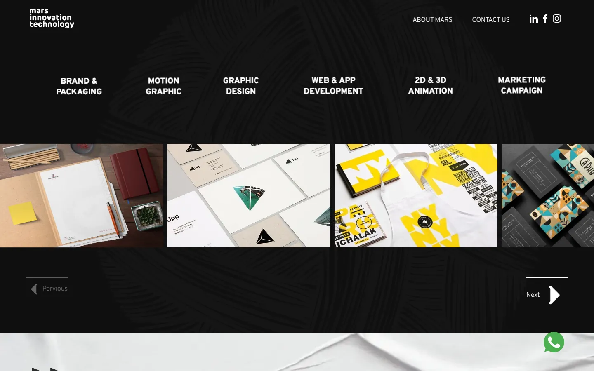

# Mars Technology

The website of Mars Technology, presenting its services (design, motion, development, animation and marketing) in a
creative, modern layout.

**[Live demo](https://devmaheremad.com/Mars-master/)** · [More of my work](https://devmaheremad.com)



## What's inside
- **One page, one section per service:** design, motion, development, animation and marketing, then contact.
- **Sliders** with Swiper and a **responsive layout** with Bootstrap.
- **Styles** written in Sass; this repository holds the compiled CSS.

## Stack
HTML · Sass (compiled CSS) · JavaScript · jQuery · Bootstrap · Swiper

## Run locally
No build step. Open `index.html` in a browser, or serve the folder:

```bash
npx serve .
```

---

**Maher Almashharawi** · Senior Frontend Engineer (React, Next.js, TypeScript)
[devmaheremad.com](https://devmaheremad.com) · [Case studies](https://devmaheremad.com/case-studies/) · [LinkedIn](https://www.linkedin.com/in/devmaheremad) · hello@devmaheremad.com
